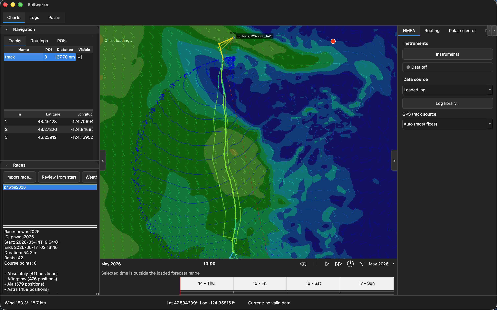
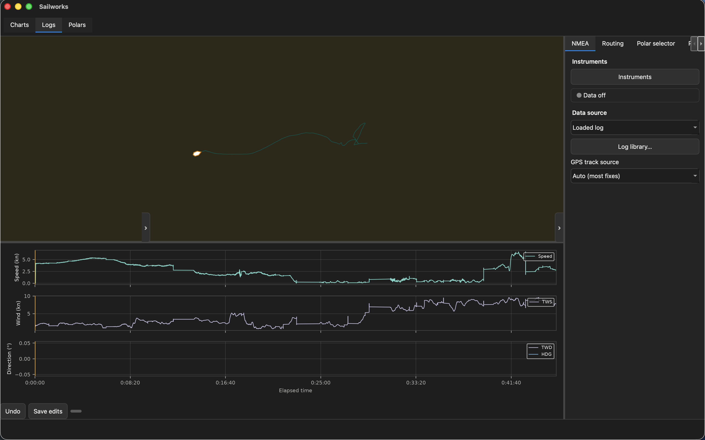
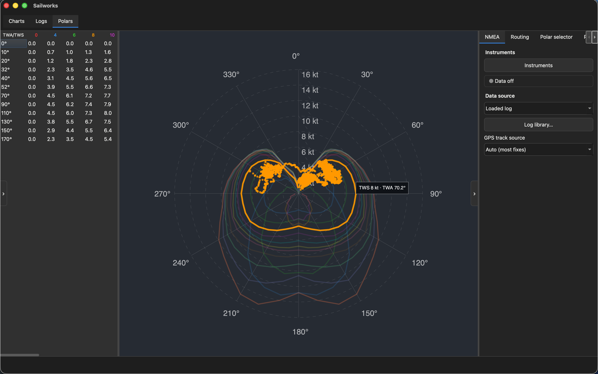

# Sailworks


[](https://www.gnu.org/licenses/gpl-3.0)

Sailworks plans sailing routes through real weather — on your own desktop, with your own
charts, your own polars, and your own instrument feed.

Pick a boat, load a forecast, set where you want to go, and Sailworks works out when to
leave and which way to go. Then watch it run on a live chart next to your instruments,
analysis tools and log replays.

It is a fork of [GWeatherRouting](https://github.com/dakk/gweatherrouting) by Davide Gessa,
built and extended as Sailworks since. See [NOTICE](NOTICE) for attribution and licensing.



*Explore routes and race tracks alongside weather forecasts.*



*Review a recorded sail with track and instrument graphs.*



*Compare boat polars with recorded sailing data.*

## What it does

**Routing**
- Multi-point weather routing with selectable routing algorithms and configurable parameters
- Current-aware routing using ECCC CIOPS-SalishSea/CIOPS-West, NOAA WCOFS and Copernicus
  SMOC currents (including their supplied tidal components)
- Boat polar library with a built-in editor — import your own, or start from the bundled
  polars (Class40, Mini 650, Mini 650 Proto, First 317, Bavaria 38, CAT 20 and more)
- Route through a forecast, compare options, and keep the results in a session

**Weather**
- GRIB1 and GRIB2 support
- Downloader for NOAA GFS, HRRR, GFS-Wave and AI-GFS; CMC HRDPS; ECMWF IFS and AIFS Single;
  and optional Google WeatherNext 3 statistics (Zarr; Google Cloud credentials required)
- Historical ERA5 reanalysis and NOAA satellite-blended NBS wind import in
  **Data Library → History**
- Wind, pressure and wave display, with a forecast timeline that keeps each model's time
  range separate
- Retained wind overlays for pan, zoom and time scrubbing; the optional GPU presenter is
  experimental (see [Renderer options](#renderer-options))

**Charts**
- GSHHS world basemap with a download helper, and GeoJSON coastlines included
- KAP, GeoTIFF and any other raster format GDAL can read, plus CM93 vector charts and offline
  PNG MBTiles
- NOAA ENC with zoom-aware selection: the chart whose scale best matches your zoom owns the
  screen, and other charts fill the gaps
- On-demand ENC download from the hover card, so you can fetch the next scale while sailing
- OpenSeaMap seamarks, and Canadian CHS chart imagery that loads as you browse Canadian waters
- Optional MapLibre satellite imagery, with online tiles or local `.pmtiles`/`.mbtiles` packs
- Offline caches for charts, ENC and imagery

**Navigation and analysis**
- NMEA 0183 and NMEA 2000 instrument input over serial or network connections, configured in
  **Settings → Connections**
- NMEA 2000 gateways using Actisense BST or N2K ASCII output (input only)
- AIS target rendering
- Realtime boat dashboard
- Session manager for POIs, tracks, routings and races, with GPX import and export
- NMEA 2000 recording with a preserved raw-PGN companion log, and W2K-1 log sync in the
  **Log library**
- NMEA and GPX log analysis, with a log library to browse and replay recorded sessions

**Desktop**
- Native Qt Widgets interface on macOS, Linux and Windows
- Smooth, cursor-centred zoom and gentle pan inertia, each switchable independently

## What it does not do

Sailworks is a planning and analysis aid, **not a primary navigation system**. Use official,
up-to-date charts and your own seamanship for navigation.

- ENC downloading currently covers NOAA's U.S. catalog; downloaded charts are snapshots
- CHS imagery is a viewing service — it does not supply depths to the routing engine
- NMEA 2000 connections are receive-only; Sailworks does not transmit on the bus
- Depth-aware routing and automatic chart updates are not implemented yet

## Installation

Sailworks runs from source on Python 3.12 or newer (CI tests 3.12 and 3.13). It needs the
GDAL Python bindings built against a matching native GDAL, and Cairo for the chart renderer.
On Linux, install GDAL, Cairo and your distribution's Python GDAL package with the OS package
manager before installing Sailworks; on macOS, the setup script below builds the matching
bindings for you. Homebrew, apt and pacman package names vary.

Using a virtual environment is recommended:

```bash
git clone https://github.com/evanlivingston/sailworks.git
cd sailworks
python3.12 -m venv .venv
source .venv/bin/activate        # Windows: .venv\Scripts\activate
python -m pip install --upgrade pip
pip install .
sailworks
```

For a development checkout, use `pip install -e .`, or `uv sync` (which also installs the
`dev` and `test` dependency groups) to install the runtime and test dependencies.

For WeatherNext 3, install the optional Zarr/GRIB dependencies and configure Google Cloud
credentials:

```bash
pip install ".[weathernext]"
# then use Application Default Credentials or choose a service-account JSON in Settings
```

Worldwide Copernicus currents need a free Copernicus Marine account, saved under
**Settings → Currents**. The `copernicusmarine` client is a base dependency; the
`marine-global` extra remains available for environments installed without it.

The optional satellite basemap uses MapLibre Native and needs Python 3.12:

```bash
pip install ".[satellite]"
# or, with uv in a development checkout:
uv sync --extra satellite
```

A local `uv sync` already installs it through the `dev` dependency group, and
`make setup-macos` installs it on Apple Silicon. The MapLibre Metal runtime is
Apple Silicon only; elsewhere the layer reports itself unavailable instead of
rendering a blank map.

It renders online imagery by default. Drop a `.pmtiles` or `.mbtiles` pack in the
`satellite` folder of the application data directory to use it offline; the layer is
enabled under Chart layers.

### macOS

Homebrew and the repository's setup script do the whole thing:

```bash
make setup-macos
source .venv/bin/activate
sailworks
```

The script installs GDAL, creates a local `.venv`, and installs Sailworks and its Python
dependencies. To install only the Homebrew dependencies, use
`brew bundle --file=tools/macos/Brewfile`.

### Launching

Qt is the default for both the installed command and module launch:

```sh
sailworks
python -m sailworks
```

`sailworks-qt` remains an alias, and the old `[qt]` install extra still works but is no longer
needed — PySide6 is a base dependency.

Useful options:

- `--log FILE` opens an interpreted NMEA log
- `--early-weather` stages chart initialisation after weather preparation; the default
  startup is unchanged. See [early-weather startup](docs/early-weather-startup.md) for limits.
- `--map-renderer {cpu,gpu}` overrides the saved map renderer for this session
- `--native-weather-fields` keeps the native weather texture cache (the default);
  `--no-native-weather-fields` restores the image-source path

### Renderer options

CPU rendering is the default. The GPU presenter is **experimental** and is enabled per
installation:

- Turn on **Settings → Display → GPU rendering (experimental)**. The change is applied on
  restart; `--map-renderer cpu` or `--map-renderer gpu` overrides it for one session without
  changing the saved choice.
- Unsupported initialisation, scene-graph errors and resource-budget failures return the
  affected map to CPU rendering.
- Validation covers Metal on Apple Silicon macOS. Other GPU backends, device-loss recovery and
  long-session memory behaviour remain unverified, so CPU stays the default.
- The GPU presenter retains base/navigation textures and wind meshes; route, track, AIS,
  dashboard and caption painting remain on the Qt widget path.

See [embedded GPU rendering](docs/gpu-embedded-rendering.md) for the host design, resource
ledger and measured limits.

## Getting started

1. Open **Settings → Connections** and add an instrument source, or load a recorded log from
   the **Log library**.
2. Choose or import your boat polar.
3. Download a forecast from the weather panel, or load a GRIB file you already have.
4. Place your start and destination, add any waypoints you want to force, and run the router.
5. Step through departure times and compare routes; save the ones worth keeping in a session.

Choose **Live data source** in the NMEA panel to read from your instruments, or **Loaded log**
to replay one.

### NMEA 2000

In **Settings → Connections**, choose **NMEA 2000** and the gateway's data format:
**Actisense BST** (for example an NGT-1) or **N2K ASCII**. A W2K-1 data server supplies
Actisense BST. Both serial and TCP/UDP connections are supported, but NMEA 2000 input is
receive-only. An N2K ASCII gateway must reassemble fast-packet and ISO transport messages
before forwarding them. Saving an NMEA log while NMEA 2000 data is present also writes a
`.n2k.log` companion with the original PGN payloads. W2K-1 EBL logs can be copied into the
library with **Logs → Log library → Sync W2K-1**. See the
[quickstart](docs/source/docs/quickstart.md#recording-nmea-2000-instruments) for gateway setup
and the Actisense simulator.

## Development

The test and lint environments are declared in `tox.ini`; the test-only packages come from the
`test` dependency group in `pyproject.toml`. Install tox (`pip install tox`) and run everything
with:

```bash
tox                     # linters + unit tests
tox -e linters          # black and flake8
tox -e unit-tests       # pytest
tox -e typecheck        # mypy
tox -e coverage         # pytest with coverage reports
```

For quick iteration, install the test group into the active environment and run a focused
file or module:

```bash
uv sync --group test
python -m pytest -q test/test_launcher.py
python -m pytest -q test/test_qt_preview.py
```

Tests marked `network` download live forecasts and run only with `GWR_NETWORK_TESTS=1`.
Native GPU tests need a desktop session and `GWR_NATIVE_GPU_TEST=1`. After changing
documentation, run `python tools/check_doc_links.py` and
`python tools/check_doc_anchors.py`. CI runs the linters on Python 3.12 and the unit tests on
Python 3.12 and 3.13.

The project also ships a rendering performance gate runner, `tools/gate_runner.py`, which
evaluates one rendering change with one command and exits non-zero on failure so CI can use
it:

```sh
python tools/gate_runner.py --list
python tools/gate_runner.py --gate residency --snapshot <snapshot> --output <dir>
python tools/gate_runner.py --gate validation --snapshot <snapshot> --output <dir> --full
```

Each gate prints one summary line, writes `<dir>/<gate>.result.json` next to the raw tool
report, and returns one of four verdicts: `PASS` (exit 0), `PASS-WITH-OPEN-CHECKS` (exit 0),
`FAIL` (exit 1, a ratified threshold was violated) or `NOT-EVALUATED` (exit 2, the gate could
not run — never confused with a failure). The tools need PySide6, NumPy, Cairo and GDAL; if
the current interpreter lacks them the runner re-executes itself under the project
virtualenv, and reports `NOT-EVALUATED` with the interpreter to use if it cannot.

The architecture these gates protect is in
[`docs/adr-001-grib-rendering-architecture.md`](docs/adr-001-grib-rendering-architecture.md);
the current renderer state and next decision are in
[`docs/rendering-performance-plan.md`](docs/rendering-performance-plan.md). The rest of the
project documentation is indexed in [`docs/README.md`](docs/README.md).

Contributions are welcome — see [CONTRIBUTING.md](CONTRIBUTING.md). Every commit needs a
`Signed-off-by` trailer (`git commit -s`).

## License and attribution

Sailworks is licensed under the GNU General Public License, version 3 or later
(`GPL-3.0-or-later`). Read [LICENSE](LICENSE) for the full text and [NOTICE](NOTICE) for the
fork point and upstream attribution. Bundled third-party assets — chart symbols, icons,
seamark data — are listed with their licenses in
[`sailworks/data/COPYRIGHT`](sailworks/data/COPYRIGHT).
